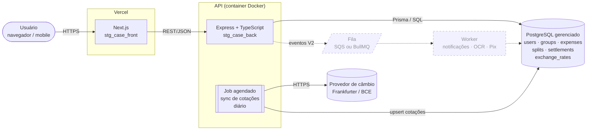
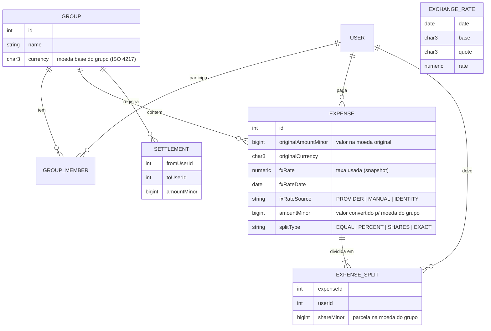

# STG Case — Rateio de Despesas Multi-moeda

API para dividir despesas entre pessoas de um grupo, com suporte a despesas lançadas em moedas diferentes da moeda do grupo.

| Repositório | Stack |
| --- | --- |
| [stg_case_back](https://github.com/Ragnavald/stg_case_back) (este) | Node.js 22 · TypeScript · Express 5 · Prisma 7 · PostgreSQL |
| [stg_case_front](https://github.com/Ragnavald/stg_case_front) | Next.js 16 · React 19 · Tailwind CSS 4 |

---

## Sumário

1. [Como rodar localmente](#1-como-rodar-localmente)
2. [Arquitetura e infraestrutura](#2-arquitetura-e-infraestrutura)
3. [Modelo de domínio e regras de dinheiro](#3-modelo-de-domínio-e-regras-de-dinheiro)
4. [Análise de edge cases (rateio e moedas)](#4-análise-de-edge-cases-rateio-e-moedas)
5. [Proposta de evolução de produto (V2)](#5-proposta-de-evolução-de-produto-v2)
6. [Plataforma implementada: API e algoritmo de quitação](#6-plataforma-implementada-api-e-algoritmo-de-quitação)
7. [Estrutura do código](#7-estrutura-do-código)

---

## 1. Como rodar localmente

Pré-requisitos: Node.js 22+ e Docker.

```bash
cp .env.example .env          # PORT e DATABASE_URL
docker compose up -d          # PostgreSQL local na porta 5432
npm install                   # também roda `prisma generate`
npm run db:migrate            # aplica as migrations
npm run dev                   # API em http://localhost:3001
```

| Script | O que faz |
| --- | --- |
| `npm test` | Testes unitários e de rota (Vitest + Supertest) |
| `npm run typecheck` | Checagem de tipos sem gerar build |
| `npm run db:studio` | Abre o Prisma Studio |
| `npm run build` / `npm start` | Build de produção e execução |

O CI (GitHub Actions) roda typecheck, testes e `prisma migrate deploy` contra um PostgreSQL efêmero em todo PR para `dev` e `main`.

---

## 2. Arquitetura e infraestrutura

### 2.1 Diagrama



Linhas tracejadas = componentes previstos para a V2 (não fazem parte do MVP).

### 2.2 Componentes

| Componente | Responsabilidade | MVP | Quando escalar |
| --- | --- | --- | --- |
| **Front-end** | UI, formulários de despesa, visualização de saldos | Next.js na **Vercel** (CDN global, deploy de preview por PR) | Mantém |
| **API** | Regras de negócio: rateio, conversão, saldos, validações | Container Docker no **Render** ou **Railway** | **AWS ECS Fargate / App Runner** em `sa-east-1`, com auto-scaling |
| **Banco** | Fonte da verdade de todos os valores monetários | **PostgreSQL** gerenciado (Neon / Render Postgres) | **AWS RDS PostgreSQL** Multi-AZ + réplica de leitura para relatórios |
| **Cotações** | Busca diária de câmbio e gravação em `exchange_rates` | Cron do provedor de hosting chamando o job | **EventBridge Scheduler** + provedor pago com SLA (ex.: Open Exchange Rates) |
| **Fila** | Trabalho assíncrono (notificações, OCR, webhooks de pagamento) | **Não necessária** — todo fluxo do MVP é síncrono | **SQS** (AWS) ou **BullMQ + Redis** |
| **CI/CD** | Typecheck, testes, migrations | GitHub Actions (já configurado) | + deploy automático após merge em `main` |

### 2.3 Por que essa stack

- **PostgreSQL** — o domínio é financeiro: uma despesa e suas parcelas precisam ser gravadas na mesma transação ACID, e o banco precisa garantir integridade com `CHECK`, `FOREIGN KEY` e tipos exatos (`BIGINT` para valores em unidade mínima, `NUMERIC` para taxas de câmbio). Um banco NoSQL empurraria essas garantias para o código da aplicação.
- **TypeScript nas duas pontas** — os mesmos contratos (DTOs, enums de moeda) podem ser compartilhados entre front e back, o que reduz divergência na fronteira da API.
- **Prisma** — migrations versionadas e revisáveis em PR (o CI já valida `migrate deploy`) e client tipado gerado a partir do schema. A versão 7 usa driver adapter (`@prisma/adapter-pg`), sem binário de engine.
- **Express 5** — mínimo e conhecido; o tratamento nativo de erros assíncronos do Express 5 elimina o boilerplate de `try/catch` nos controllers. A organização em módulos (`routes → controller → service → repository`) isola a regra de rateio no service, onde é testada sem HTTP nem banco.
- **Cotações persistidas no Postgres em vez de Redis** — a tabela `exchange_rates` serve ao mesmo tempo como cache e como trilha de auditoria ("qual taxa foi usada nesta despesa?"). No volume do MVP, um índice em `(date, base, quote)` é suficiente, e o Redis só entra se a fila da V2 usar BullMQ.
- **Sem fila no MVP** — criar despesa, ratear e consultar saldo são operações rápidas e precisam de resposta imediata. Adicionar fila agora traria custo operacional sem benefício; ela entra junto com as funcionalidades assíncronas da V2.

---

## 3. Modelo de domínio e regras de dinheiro



**Regras invariantes** (validadas no service e cobertas por testes):

1. **Dinheiro nunca é `float`.** Valores são armazenados como inteiros na **unidade mínima** da moeda (centavos, ienes, fils) em colunas `BIGINT`. Na API, valores trafegam como **string decimal** (`"123.45"`) e são convertidos para inteiro por parsing de texto, nunca via `parseFloat`.
2. **`SUM(expense_splits.shareMinor) = expense.amountMinor`** para toda despesa, sem exceção.
3. **Converte primeiro, divide depois.** O total é convertido para a moeda do grupo **uma única vez** e só então rateado, de modo que o arredondamento acontece uma vez e a soma das parcelas fecha.
4. **A taxa é um snapshot.** A taxa usada é gravada na própria despesa, então saldos passados não mudam quando o câmbio muda.
5. **Saldos são derivados**, nunca armazenados: `saldo(u) = Σ pagou em despesas − Σ sua parte + Σ acertos enviados − Σ acertos recebidos`, tudo em inteiros (positivo = tem a receber). Quem paga um acerto reduz a própria dívida, por isso o acerto enviado **soma**. Isso garante `Σ saldos do grupo = 0` exatamente.

> **Status do MVP:** cada grupo tem uma moeda (com expoente ISO 4217) e todas as despesas são lançadas nela. Os campos de câmbio (`originalAmountMinor`, `fxRate*`) e a tabela `exchange_rates` do diagrama acima, assim como as seções 4.3 e 4.4, descrevem o desenho da conversão multi-moeda, que ainda não foi implementada.

---

## 4. Análise de edge cases (rateio e moedas)

### 4.1 Divisão que não fecha (o "centavo perdido")

**Cenário:** R$ 100,00 dividido igualmente entre 3 pessoas. `100 / 3 = 33,333…`. Arredondar cada parcela para R$ 33,33 soma R$ 99,99, e o grupo "perde" R$ 0,01.

**Como a aplicação trata:** **método do maior resto** (Hamilton), operando em centavos inteiros:

1. Calcula a parcela base com divisão inteira: `10000 / 3 = 3333` centavos para cada um (soma 9999).
2. Sobra `10000 − 9999 = 1` centavo.
3. Os centavos restantes vão, um por vez, para quem tem a maior parte fracionária descartada; empates são resolvidos por `userId` crescente, o que torna o resultado determinístico.

Resultado: `[3334, 3333, 3333]`, com soma exata de 10000. A diferença máxima entre participantes é sempre de 1 unidade mínima. O mesmo algoritmo atende `EQUAL`, `PERCENT` (ex.: 33,3% / 33,3% / 33,4%) e `SHARES` (pesos 2:1:1).

### 4.2 Moedas com número diferente de casas decimais

**Cenário:** o código assume 2 casas decimais para tudo. Um jantar de **¥ 3.000** (JPY, 0 casas) vira 30,00 ienes, e uma despesa de **KWD 12,345** (dinar kuwaitiano, 3 casas) é truncada para 12,34.

**Como a aplicação trata:**
- Uma tabela de expoentes baseada na ISO 4217 (`BRL: 2`, `USD: 2`, `JPY: 0`, `KWD: 3`, `BHD: 3`…) define a unidade mínima de cada moeda. Nenhum ponto do código usa um `100` fixo.
- A entrada é validada contra o expoente da moeda: `"10.005"` em BRL é rejeitado com `400` (precisão maior do que a moeda permite), e `"3000.5"` em JPY também.
- Moedas fora da lista suportada retornam `400 Unsupported currency`.

### 4.3 Despesa em moeda estrangeira: arredondamento de conversão e acúmulo de erro

**Cenário:** um grupo em **BRL** lança um hotel de **US$ 100,00** para 3 pessoas, com taxa de 5,4322. Se cada parcela em USD (33,34 / 33,33 / 33,33) fosse convertida separadamente e arredondada, a soma em BRL poderia diferir em ±1 centavo do total convertido, e esse erro se acumularia a cada despesa.

**Como a aplicação trata:**
1. Converte o **total** uma única vez: `10000 × 5,4322 = 54322` centavos de BRL. A taxa é armazenada como `NUMERIC(18,8)` e a conta é feita em aritmética decimal exata (`Prisma.Decimal`), com arredondamento **half-even** (bancário) para não enviesar sistematicamente para cima.
2. Aplica o maior resto (4.1) sobre o valor já convertido: `[18108, 18107, 18107]`, com soma exata de 54322.
3. Grava na despesa o valor original (`10000 USD`), a taxa, a data e a fonte da cotação, para que qualquer saldo possa ser auditado depois.

### 4.4 Cotação indisponível ou em data sem pregão

**Cenário:** despesa lançada num **sábado** ou feriado (o BCE não publica cotação), em uma data futura, ou com o provedor de câmbio fora do ar.

**Como a aplicação trata:**
- Usa a **cotação mais recente com data ≤ data da despesa** presente em `exchange_rates`, que é a prática de mercado para dias sem pregão. A data efetiva da taxa fica gravada em `fxRateDate`.
- A API não depende do provedor em tempo de requisição: o job diário popula a tabela, e se ele falhar a despesa ainda é aceita com a última taxa conhecida.
- Se não existe nenhuma cotação para o par (moeda recém-adicionada), retorna `422` com mensagem clara, e o usuário pode informar a taxa manualmente (`fxRateSource = MANUAL`). Isso cobre o caso real em que a pessoa sabe exatamente quanto o cartão cobrou.
- Despesas com data futura são rejeitadas com `400`.
- Quando a moeda da despesa é igual à do grupo, não há conversão: `fxRate = 1` e `fxRateSource = IDENTITY`.

### 4.5 Entradas de rateio inconsistentes

| Cenário | Resposta |
| --- | --- |
| Percentuais somam ≠ 100% (ex.: 50% + 30%) | `400` — a soma deve ser exatamente 100, comparada em decimal e não em float |
| Valores `EXACT` não somam o total (R$ 60 + R$ 30 numa despesa de R$ 100) | `400` informando a diferença |
| Valor zero ou negativo | `400` — estornos são lançados como acerto (`settlement`), não como despesa negativa |
| Participante repetido, ou que não é membro do grupo | `400` |
| Lista de participantes vazia, ou todos com peso 0 em `SHARES` | `400` (evita divisão por zero) |
| Pagador não participa do rateio (pagou para os outros) | **Válido** — o pagador fica com saldo credor igual ao total |
| Valor acima do limite seguro (> 2⁵³ unidades mínimas no JSON) | `400` — protege a fronteira entre `BIGINT` e `number` do JavaScript |

### 4.6 Remoção de membro com saldo pendente

**Cenário:** remover do grupo um usuário que ainda deve (ou tem a receber) R$ 0,01 após vários arredondamentos.

**Como a aplicação trata:** como os saldos são inteiros e derivados (regra 5 da seção 3), não há resíduo fantasma de ponto flutuante: o saldo é exatamente zero ou não é. A remoção só é permitida com saldo `= 0`; caso contrário retorna `409 Conflict` com o valor pendente, para que o acerto seja registrado antes.

---

## 5. Proposta de evolução de produto (V2)

Três melhorias de negócio, priorizadas por impacto sobre o principal problema do produto: **despesas são registradas, mas dívidas não são quitadas**.

### 5.1 Simplificação de dívidas (mínimo de transferências) — ✅ entregue no MVP

> Implementada com algoritmo **ótimo** (não apenas guloso); ver [seção 6.2](#62-algoritmo-de-simplificação-de-saldo).

**O que é:** em vez de mostrar "A deve a B, B deve a C, C deve a A", o sistema calcula o **menor conjunto de transferências** que zera todos os saldos. Exemplo: 6 pessoas com 15 dívidas cruzadas passam a precisar de no máximo 5 Pix.

**Impacto no negócio:**
- Menos atrito para quitar → maior **taxa de liquidação** (métrica norte do produto).
- Diferencial percebido ("o app resolve a conta para mim"), o que favorece retenção e indicação.
- **Custo técnico baixo:** os saldos já são derivados em inteiros, então a simplificação roda sobre eles sem mudança de schema.

### 5.2 Acerto integrado via Pix

**O que é:** a partir de cada transferência sugerida, o app gera um **Pix Copia e Cola / QR Code com o valor já preenchido** (usando a chave Pix cadastrada pelo credor). Na fase 2, a integração com um PSP (via webhook) **marca a dívida como paga automaticamente** quando o Pix cai.

**Impacto no negócio:**
- Fecha o ciclo dentro do app: hoje o usuário sai, faz o Pix no banco e volta para marcar como pago (e muitas vezes esquece).
- Reduz disputas ("eu já te paguei!") com comprovação automática.
- **Abre monetização:** parcerias com PSPs/bancos digitais ou cobrança por conciliação automática em grupos grandes (repúblicas, condomínios, viagens corporativas).
- **Impacto técnico:** introduz a **fila** do diagrama, porque webhooks do PSP precisam ser processados de forma idempotente e com retry, fora do ciclo de requisição.

### 5.3 Despesas recorrentes e lembretes automáticos

**O que é:** cadastrar despesas que se repetem (aluguel, internet, streaming) uma única vez, com geração automática a cada ciclo, e enviar **lembretes de cobrança** (e-mail / push / WhatsApp) para quem tem saldo devedor há mais de X dias.

**Impacto no negócio:**
- Transforma o app de "uso em viagem" (esporádico) em **uso mensal recorrente** (repúblicas, casais, colegas de apartamento), elevando DAU/MAU e LTV.
- O lembrete parte do sistema e não do amigo, o que tira o constrangimento social de cobrar e aumenta a taxa de liquidação.
- **Impacto técnico:** usa o mesmo job agendado das cotações para gerar as recorrências e a fila/worker para disparar notificações com retry e controle de frequência, evitando spam.

### Métricas para validar a V2

| Métrica | Hipótese |
| --- | --- |
| % de saldos liquidados em até 7 dias | ↑ com 5.1 + 5.2 |
| Nº médio de transferências por grupo para zerar | ↓ com 5.1 |
| Retenção em 30/90 dias | ↑ com 5.3 |
| Grupos com ≥ 1 despesa por mês | ↑ com 5.3 |

---

## 6. Plataforma implementada: API e algoritmo de quitação

### 6.1 Funcionalidades

| Requisito | Onde |
| --- | --- |
| Grupos com múltiplos integrantes (novas pessoas por nome ou reaproveitando quem já existe) | `modules/groups` |
| Despesa paga por 1 pessoa e dividida entre N: **igualitário**, **porcentagem**, **valor fixo** e **pesos** | `modules/expenses` + `domain/split.ts` |
| Cálculo de quem deve a quem com o **mínimo de transferências** | `domain/settle.ts` |
| Extrato individual (despesa a despesa, com saldo acumulado) e plano de liquidação | `domain/ledger.ts` + `GET /groups/:id/balances`, `.../statement` |
| Registro de pagamentos e fechamento do grupo (opcionalmente quitando o plano inteiro em uma transação) | `modules/settlements`, `POST /groups/:id/close` |

A regra de negócio fica toda em `src/domain/`, sem dependência de HTTP ou banco, e é testada isoladamente (`npm test`).

### 6.2 Algoritmo de simplificação de saldo

1. **Saldos líquidos:** cada pessoa tem um único número (regra 5 da seção 3). Isso já resolve o exemplo clássico: se A deve 50 a B e B deve 50 a C, o saldo de B é 0, e a única transferência sugerida é **A → C: 50**.
2. **Mínimo de transferências:** um conjunto de transferências forma um grafo em que cada componente conexo soma zero, e um componente com *k* pessoas precisa de pelo menos *k − 1* transferências. Logo, o mínimo é `n − (máximo de subgrupos disjuntos de soma zero)`.
3. **Partição exata:** esse máximo é calculado por programação dinâmica sobre bitmasks em O(2ⁿ · n): `dp[mask] = max_i dp[mask \ {i}] + [Σ(mask) = 0]`. Percorrer o argmax a partir do conjunto completo devolve os subgrupos.
4. **Dentro de cada subgrupo:** o maior devedor paga ao maior credor até zerar, o que dá no máximo *k − 1* transferências por subgrupo.
5. **Grupos grandes (> 16 pessoas com saldo ≠ 0):** o problema é NP-difícil (generaliza subset-sum), então o algoritmo casa primeiro pares de saldos opostos idênticos e aplica o guloso no restante, mantendo a garantia de no máximo *n − 1* transferências.

Por que não apenas o guloso? Com saldos `{−6, −4, +3, +4, +3}`, o guloso gera 4 transferências, enquanto a partição `{−4, +4}` + `{−6, +3, +3}` resolve com 3. Os testes comparam o resultado contra força bruta em 300 grupos aleatórios.

O painel mostra lado a lado quantos pagamentos seriam necessários **sem simplificação** (cada participante paga de volta a cada pagador, compensando apenas dentro do mesmo par) e **com simplificação**, ambos calculados sobre as mesmas despesas.

### 6.3 Endpoints

Valores monetários trafegam como **string decimal** na moeda do grupo (`"100.00"`).

| Método | Rota | Descrição |
| --- | --- | --- |
| `GET` | `/currencies` | Moedas suportadas e seus expoentes |
| `GET` / `POST` | `/users` | Pessoas |
| `GET` | `/groups` | Lista de grupos com total gasto |
| `POST` | `/groups` | `{ name, currency?, members: [{ userId } \| { name }] }` |
| `GET` | `/groups/:id` | Grupo e integrantes |
| `POST` | `/groups/:id/members` | `{ userId } \| { name }` |
| `DELETE` | `/groups/:id/members/:userId` | `409` se o saldo da pessoa ≠ 0 |
| `GET` / `POST` | `/groups/:id/expenses` | `{ description, amount, payerId, date?, splitType, participants: [{ userId, value? }] }` |
| `DELETE` | `/groups/:id/expenses/:expenseId` | Exclui a despesa |
| `GET` / `POST` | `/groups/:id/settlements` | `{ fromUserId, toUserId, amount }` registra um pagamento |
| `DELETE` | `/groups/:id/settlements/:settlementId` | Desfaz um pagamento |
| `GET` | `/groups/:id/balances` | Saldos, plano de quitação e comparação sem/com simplificação |
| `GET` | `/groups/:id/members/:userId/statement` | Extrato individual com saldo acumulado |
| `POST` | `/groups/:id/close` | `{ settleAll?: boolean }`; sem `settleAll`, exige saldos zerados (`409`) |
| `POST` | `/groups/:id/reopen` | Reabre um grupo fechado |

`value` depende do `splitType`: ignorado em `EQUAL`; percentual em `PERCENT` (até 4 casas, soma exatamente 100); peso em `SHARES`; valor na moeda em `EXACT` (soma = total). Grupos fechados recusam alterações com `409`.

---

## 7. Estrutura do código

Uma requisição percorre as camadas sempre na mesma ordem, e a regra de negócio fica isolada em `domain/`:

```
routes → controller → service → repository → Prisma / PostgreSQL
                         │
                         └──► domain/  (cálculos puros: sem HTTP, sem banco)
```

### 7.1 Raiz de `src/`

| Arquivo / pasta | O que faz |
| --- | --- |
| `index.ts` | Ponto de entrada: carrega o `.env` e sobe o servidor na `PORT` (padrão 3001) |
| `app.ts` | Monta o Express: CORS, parser de JSON, rotas e o tratador de erros no final |
| `routes.ts` | Roteador raiz: `/health`, `/currencies` e os módulos `/users` e `/groups` |
| `config/db.ts` | Cria o `PrismaClient` único da aplicação, conectado via `@prisma/adapter-pg` |
| `lib/http.ts` | Utilitários HTTP: `parseId` (valida ids de rota e responde `400` em vez de deixar `NaN` chegar ao banco) e `toDateOnly` (data em `YYYY-MM-DD`) |
| `middlewares/errorHandler.ts` | Classe `AppError` (erro de negócio com status HTTP) e o middleware que converte `AppError`, erros do Zod e JSON malformado em respostas `4xx`; qualquer outro erro vira `500` |
| `generated/prisma/` | Client tipado gerado pelo `prisma generate` a partir de `prisma/schema.prisma`. **Não editar à mão** |

### 7.2 `domain/`: regra de negócio pura

| Arquivo | O que faz |
| --- | --- |
| `money.ts` | Dinheiro como inteiro (`bigint`) na unidade mínima da moeda. Tabela de expoentes ISO 4217, parse de `"100.50"` para inteiro sem `parseFloat` e formatação de volta para string |
| `split.ts` | Rateio de uma despesa nos modos `EQUAL`, `PERCENT`, `SHARES` e `EXACT`, usando o método do maior resto. As parcelas sempre somam exatamente o total |
| `ledger.ts` | Saldos derivados de despesas e acertos (`pagou − deve + enviou − recebeu`), extrato individual com saldo acumulado e contagem de dívidas sem simplificação |
| `settle.ts` | Simplificação de dívidas: menor número de transferências que zera o grupo. Usa programação dinâmica exata até 16 pessoas e um algoritmo guloso acima disso (seção 6.2) |

### 7.3 `modules/`: um módulo por recurso da API

Todos os módulos seguem o mesmo padrão de arquivos:

| Sufixo | Camada | Responsabilidade |
| --- | --- | --- |
| `*.routes.ts` | Rotas | Associa método + URL ao controller |
| `*.controller.ts` | HTTP | Lê `params` e `body`, valida com o schema, chama o service e devolve o status HTTP |
| `*.schemas.ts` | Validação | Schemas Zod do corpo das requisições (formato e tipos) |
| `*.service.ts` | Aplicação | Regras do caso de uso: verifica se o grupo existe e está aberto, se os participantes são membros, chama `domain/` e formata a resposta |
| `*.repository.ts` | Dados | Única camada que fala com o Prisma (consultas e transações) |

| Módulo | Rotas | O que cobre |
| --- | --- | --- |
| `users/` | `/users` | Cadastro e listagem de pessoas. Usa `user.types.ts` (interfaces) no lugar de schemas Zod |
| `groups/` | `/groups` | Grupos e membros, saldos e plano de quitação, extrato individual, fechar e reabrir grupo. Exporta `requireGroup`, `requireOpen` e `requireMembers`, reaproveitados pelos outros módulos |
| `expenses/` | `/groups/:groupId/expenses` | Lançar, listar e excluir despesas, calculando as parcelas com `domain/split.ts` |
| `settlements/` | `/groups/:groupId/settlements` | Registrar, listar e desfazer pagamentos entre membros |

### 7.4 Fora de `src/`

| Pasta / arquivo | O que faz |
| --- | --- |
| `prisma/schema.prisma` | Modelo de dados (tabelas, relações, tipos) |
| `prisma/migrations/` | Migrations SQL versionadas, aplicadas com `npm run db:migrate` |
| `tests/domain/` | Testes unitários das funções de `domain/`, sem HTTP e sem banco |
| `tests/<módulo>/` | Testes de rota com Supertest por módulo (`users/` também testa o service) |
| `tests/*.test.ts`, `tests/lib/` | Testes do `/health`, do tratador de erros e de `lib/http.ts` |
| `docker-compose.yml` | PostgreSQL local para desenvolvimento |
| `dist/` | Saída do `npm run build` (gerada, não editar) |
